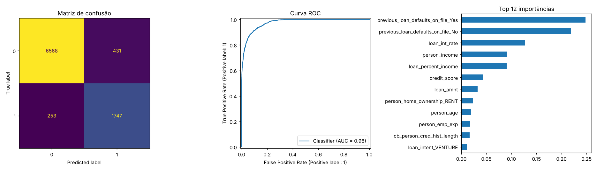

# Aprovação de empréstimos com Random Forest

Desafio Rocketseat: prever `loan_status` (aprovado = 1, rejeitado = 0) a partir de 13 variáveis pessoais, profissionais e financeiras (dataset sintético, 45.000 registros — Kaggle: Loan Approval Classification Data).

## Etapas
1. Exploração e limpeza (remoção de 7 registros com idade/experiência irreais)
2. Pré-processamento com `ColumnTransformer` + One-Hot Encoding em um `Pipeline`
3. Split estratificado 80/20 e `class_weight="balanced"` (classes ~78/22)
4. `RandomizedSearchCV` com validação cruzada estratificada, otimizando F1
5. Avaliação no teste: precisão, recall, F1, matriz de confusão, curva ROC e importância das variáveis

## Resultados (conjunto de teste)
| Classe | Precisão | Recall | F1 |
|---|---|---|---|
| Rejeitado | 0,96 | 0,94 | 0,95 |
| Aprovado | 0,80 | 0,87 | 0,84 |

Acurácia 0,92 · ROC AUC 0,975



Variáveis mais importantes: histórico de inadimplência anterior, taxa de juros, renda e percentual da renda comprometido.

## Como rodar
```bash
pip install pandas scikit-learn matplotlib joblib jupyter
# coloque loan_data.csv na mesma pasta
jupyter notebook random_forest_emprestimos.ipynb   # ou: python random_forest_emprestimos.py
```
